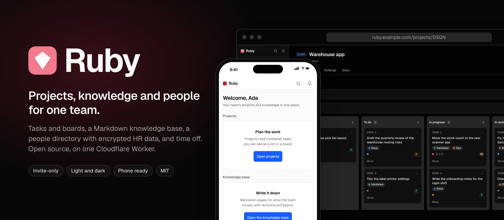
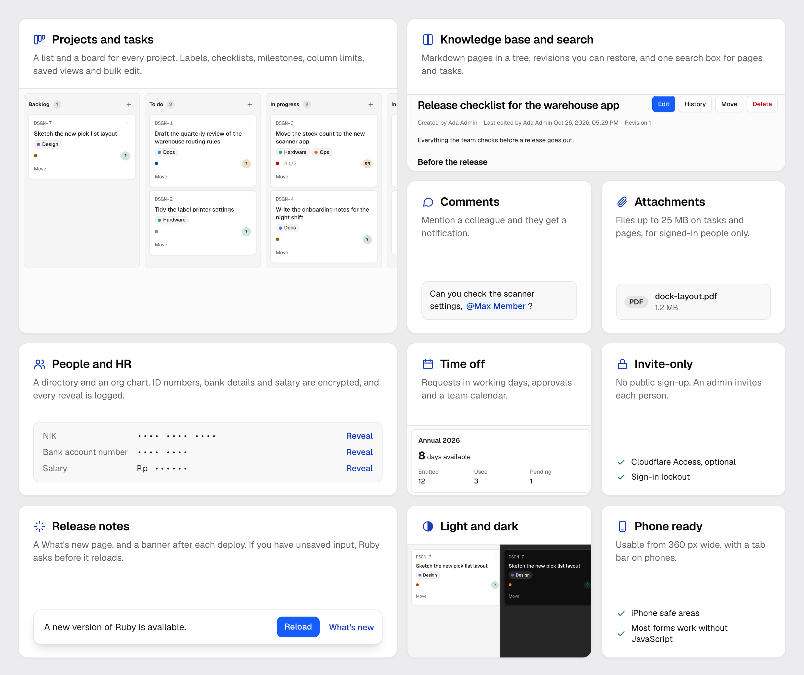
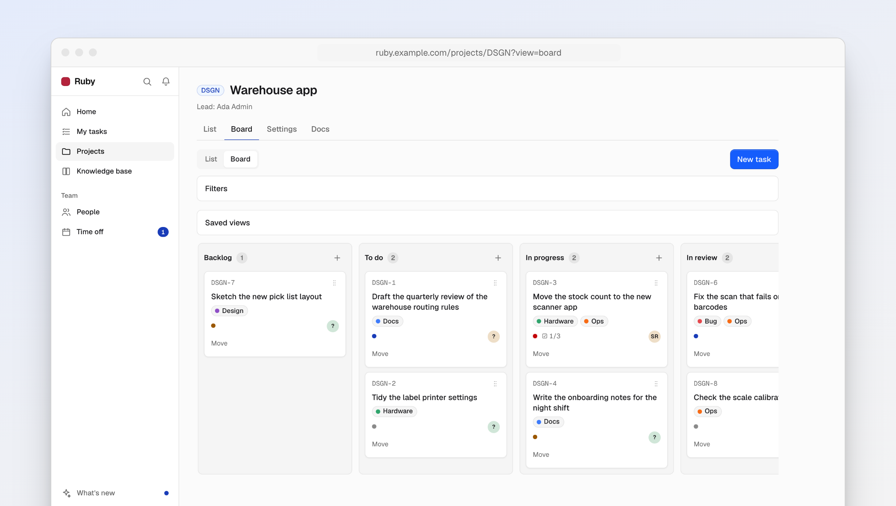
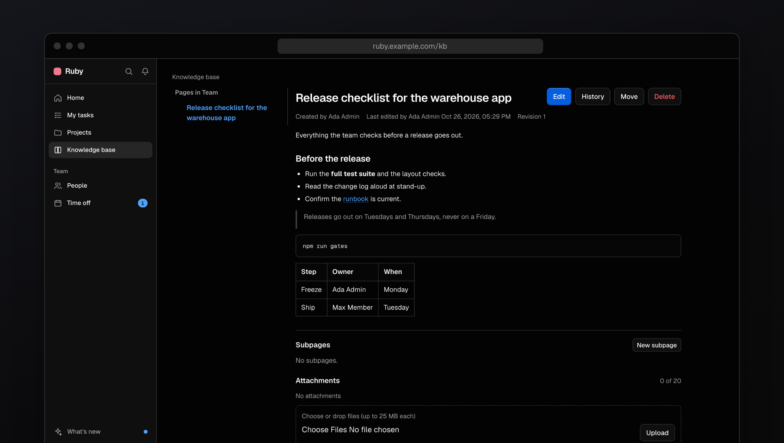
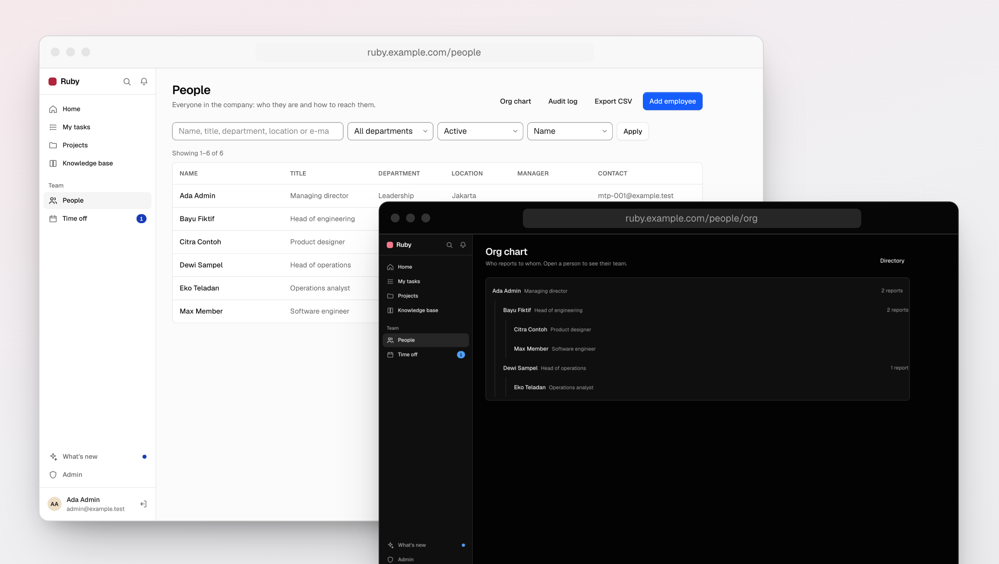
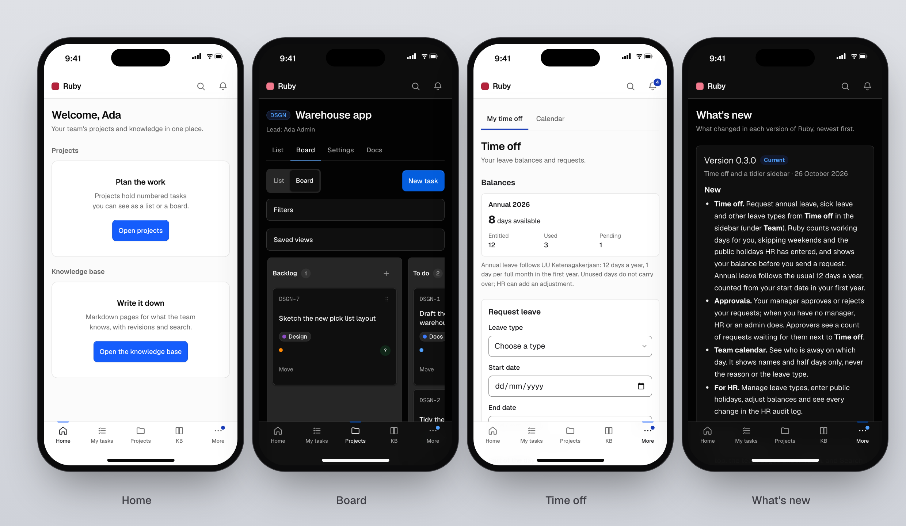
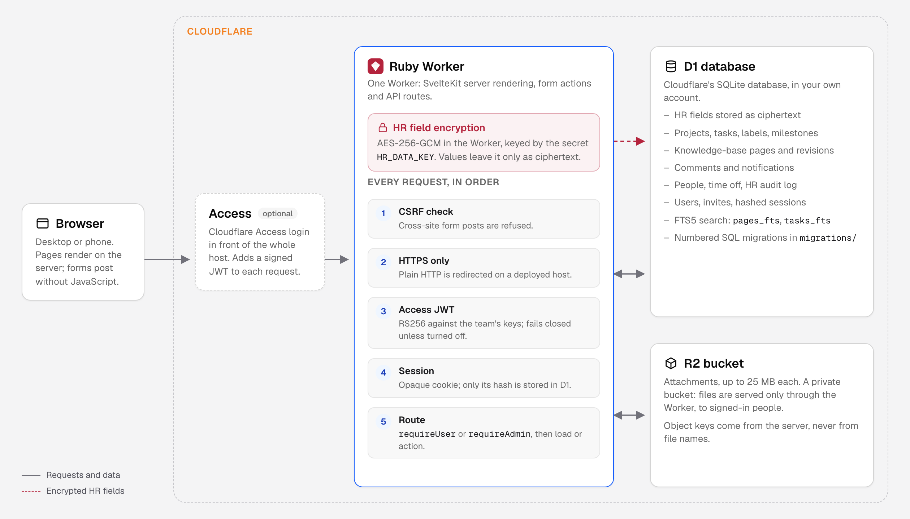

<p align="center">
  
</p>

<p align="center">
  <b>Plan the work, write down what the team knows, and keep track of who is on the team, in one app you host yourself.</b><br>
  Invite-only, open source, and running on a single Cloudflare Worker with D1 and R2.
</p>

<p align="center">
  
  
  
  
  <a href="LICENSE"></a>
  <a href="https://github.com/studiomicro/ruby/actions/workflows/ci.yml"></a>
  <a href="https://github.com/studiomicro/ruby/actions/workflows/codeql.yml"></a>
</p>

> **Ruby is the internal tool of one small company**, built by Macan Teknologi Perkasa and released under the MIT
> licence. It covers the daily work of one team and nothing more: there is no public sign-up, no billing and no
> multi-tenancy, and every active user sees every project, task and page. The interface is in English; some HR
> defaults (ID fields, the annual leave rule, the team time zone) follow Indonesian practice. Features land when that
> team needs them, so issues and pull requests are welcome but answered as time allows.

<br>

<p align="center">
  
</p>

## What it does

|                                       |                                                                                                                                                                                                                                                                                         |
| ------------------------------------- | --------------------------------------------------------------------------------------------------------------------------------------------------------------------------------------------------------------------------------------------------------------------------------------- |
| **Invite-only accounts**              | Nobody signs up. An admin invites each person with a one-use link and sets their role. Sign-in locks after repeated failures. Cloudflare Access can sit in front as a second gate.                                                                                                      |
| **Projects and tasks**                | Numbered tasks (`OPS-12`) with status, priority, assignee and due date, in a list or on a board. Drag cards, move them with the keyboard, or use the move buttons without JavaScript. **My tasks** shows what is yours.                                                                 |
| **Labels, checklists and milestones** | Coloured labels, checklist steps on a task, milestones with a progress page, soft limits per board column, and columns you can rename or hide per project.                                                                                                                              |
| **Saved views and bulk edit**         | Save a set of filters as a view. Change status, priority, assignee, milestone, due date or labels on up to 100 tasks at once.                                                                                                                                                           |
| **Knowledge base**                    | Markdown pages in a tree, for the whole team or for one project, with a preview, a history of every revision and restore. If two people edit the same page, Ruby shows both versions instead of overwriting one.                                                                        |
| **Search**                            | One search box for pages and tasks, backed by SQLite full-text search.                                                                                                                                                                                                                  |
| **Comments and notifications**        | Comments on tasks and pages with @mentions. You are notified when you are mentioned, when someone comments on your task, and when a task is assigned to you.                                                                                                                            |
| **Attachments**                       | Files up to 25 MB on tasks and pages, kept in a private bucket and downloaded only by signed-in people.                                                                                                                                                                                 |
| **People and HR**                     | A directory, profiles and an org chart. ID numbers, bank details, home address and salary are encrypted with AES-256-GCM, shown masked, and revealed one at a time by HR (or by the person, for their own details except salary). Every reveal, change and export goes in an audit log. |
| **Time off**                          | Leave requests counted in working days, with weekends, holidays and half days handled. Balances, approval by your manager (or HR when you have none), and a team calendar that shows names only, never the reason.                                                                      |
| **Release notes**                     | A **What's new** page, and a banner with **Reload** when a new version is deployed. If you have typed something you have not saved, Ruby asks first.                                                                                                                                    |
| **Light, dark and phone**             | Follows your system theme. On a phone, a bottom tab bar and a layout that keeps clear of the Dynamic Island and the home indicator. Most forms work without JavaScript.                                                                                                                 |

<p align="center">
  
</p>
<p align="center"><sub>A project board with labels and a checklist count.</sub></p>

<p align="center">
  
</p>
<p align="center"><sub>A knowledge-base page in dark mode, with Edit, History and Move.</sub></p>

<p align="center">
  
</p>
<p align="center"><sub>The people directory and the org chart.</sub></p>

<p align="center">
  
</p>
<p align="center"><sub>Home, a board, time off and What's new on an iPhone. All screenshots use fictional demo data.</sub></p>

## Coming next

- **Calendar and reminders** (RB-09): one calendar for due dates, milestones, leave and team events, and reminders
  delivered as in-app notifications.
- **Issues and team labels** (RB-12): one place for open issues across projects, and labels shared by every project.
- **Onboarding and offboarding checklists** (RB-07).

These are planned, not built. What is live is listed in [What's new](src/lib/content/releases/) and
[docs/HISTORY.md](docs/HISTORY.md).

## Requirements

|                       |                                                                                                                         |
| --------------------- | ----------------------------------------------------------------------------------------------------------------------- |
| **Cloudflare**        | An account with one Worker, one D1 database and one R2 bucket. A free account is enough to start; check its CPU limits. |
| **Domain**            | A domain on Cloudflare, for the Worker's custom domain.                                                                 |
| **Node.js**           | 22 or newer, to build and deploy. Local development needs no Cloudflare account.                                        |
| **Cloudflare Access** | Optional. A Zero Trust self-hosted application in front of the host.                                                    |
| **Browser**           | Any current browser on a desktop or a phone, from 360 px wide.                                                          |

## How it works

Ruby is one SvelteKit 3 app (Svelte 5, TypeScript in strict mode) built with the Cloudflare adapter into a single
Worker. There are no queues, no KV, no background jobs and no other services.

- **Every request** passes the same hooks, in order: a CSRF check on form posts, HTTPS on a deployed host, the
  Cloudflare Access JWT (verified by the Worker with RS256 against your team's keys; it fails closed unless you turn
  Access off), then the session. Each load, form action, API route and download then checks the user's role on the
  server.
- **Data** lives in D1 through Drizzle, with numbered SQL migrations in [`migrations/`](migrations/). Search uses
  SQLite FTS5 tables kept current by triggers.
- **Attachments** live in R2 under keys the server generates. Their metadata is in D1.
- **HR fields** are encrypted in the Worker with AES-256-GCM under the secret `HR_DATA_KEY`, with a fresh IV per value.
  Without the key they stay read-only.
- **Markdown** from users goes through one renderer with raw HTML off and link checks.

<p align="center">
  
</p>

The design follows Cloudflare's Kumo design system: Ruby ports its token values and rebuilds the components in
Svelte ([docs/design/DESIGN_SYSTEM.md](docs/design/DESIGN_SYSTEM.md)).

## Run it locally

Node 22 or newer.

```sh
npm ci
npm run db:reset:local   # a fresh local D1 with all migrations
npm run db:seed:local    # fictional sample data, local only
npm run dev
```

Sign in as `admin@example.test` with the password `ruby-local-demo`. Both exist only in your local database. To try
the HR fields, put `HR_DATA_KEY=<random value>` in `.dev.vars` (gitignored).

## Self-hosting

The full guide is [docs/SELF_HOSTING.md](docs/SELF_HOSTING.md). In short:

1. **Install and log in:** `npm ci`, then `npx wrangler login`.
2. **Create the storage:** `npx wrangler d1 create ruby` and `npx wrangler r2 bucket create ruby-files`. Keep the
   bucket private.
3. **Fill `.deploy.env`** from `.deploy.env.example`: your account id, the D1 id, the host name, and either your
   Access team domain and audience tag or `RUBY_ACCESS_DISABLED=1`. The file is gitignored.
4. **Deploy:** `npm run gates`, then `npm run deploy`. It records a D1 Time Travel bookmark, applies the migrations,
   builds and deploys. `node scripts/deploy.ts --dry-run` shows what it would do first.
5. **Set the HR key** with `npx wrangler secret put HR_DATA_KEY`, as the guide shows. Keep a copy in a password
   manager: a lost key cannot be recovered.
6. **Create the first admin** at `https://<your host>/setup`, then invite everyone else from **Admin › Users**.

Updates: pull, run `npm run gates`, commit, and run `npm run deploy` again. Operations and rollback are in
[docs/RUNBOOK.md](docs/RUNBOOK.md).

## What Ruby does with your data and accounts

**It keeps everything in your own Cloudflare account.** Data is in your D1 database and files are in your R2 bucket.
The repository holds placeholders only: your account id, database id and host stay in `.deploy.env`, and the deploy
script writes them to a temporary config that it deletes afterwards.

**It does not call other services.** There is no analytics, no tracking, no AI and no e-mail sending. Fonts are
self-hosted. The only outbound request is to your Access team's signing keys, and only while Access is on. Invite
links are shown to the admin to pass on.

**It changes only what the deploy says.** `npm run deploy` creates a Time Travel bookmark, applies the migrations to
your D1 database, and deploys the Worker with your host as its custom domain. It never seeds or resets a remote
database.

**It keeps logs short.** One line per request: method, route, status and duration. Never the query string, the body,
page or comment text, or HR data. Cloudflare's own invocation logs are turned off because they would include invite
links.

**It protects secrets.** Passwords are hashed with PBKDF2-SHA256, sessions are stored as hashes, and HR fields are
stored as ciphertext. Every response carries `X-Robots-Tag: noindex`, and signed-in pages are
never cached.

**What it does not do.** There are no per-project permissions: every active user sees every project, task and page.
Deleted tasks, pages and comments are soft deleted and stay in D1. Deleted attachments are removed from R2, and an
admin can purge files whose task or page was deleted 30 or more days ago. Ruby cannot read HR fields without
`HR_DATA_KEY`, and nobody can recover them if the key is lost.

## Credits

- **Design:** token values from [Kumo](https://github.com/cloudflare/kumo) by Cloudflare (MIT), and the
  [Geist](https://vercel.com/font) fonts by Vercel (SIL Open Font License 1.1). Details in
  [THIRD_PARTY_NOTICES.md](THIRD_PARTY_NOTICES.md).
- **Built with:** [SvelteKit](https://svelte.dev/docs/kit) and [Svelte](https://svelte.dev),
  [Drizzle ORM](https://orm.drizzle.team), [markdown-it](https://github.com/markdown-it/markdown-it),
  [Tailwind CSS](https://tailwindcss.com), [Vitest](https://vitest.dev) and [Playwright](https://playwright.dev), on
  Cloudflare [Workers](https://developers.cloudflare.com/workers/), [D1](https://developers.cloudflare.com/d1/) and
  [R2](https://developers.cloudflare.com/r2/).
- **Ruby:** built by Macan Teknologi Perkasa and
  [everyone who has contributed](https://github.com/studiomicro/ruby/graphs/contributors).

## Contributing

Issues and pull requests are welcome. Read [CONTRIBUTING.md](CONTRIBUTING.md) and the
[Code of Conduct](CODE_OF_CONDUCT.md). Before a pull request, run `npm run gates` (type check, lint, tests and build).
Project rules for contributors and coding agents are in [CLAUDE.md](CLAUDE.md).

## Security

Please report a vulnerability privately, as described in [SECURITY.md](SECURITY.md). Do not open a public issue for
it.

## License

[MIT](LICENSE) &copy; 2026 Macan Teknologi Perkasa. Third-party notices are in
[THIRD_PARTY_NOTICES.md](THIRD_PARTY_NOTICES.md).

<sub>Ruby is not affiliated with Cloudflare or Vercel. Cloudflare, Workers, D1 and R2 are trademarks of Cloudflare,
Inc. Screenshots show fictional people and data.</sub>
