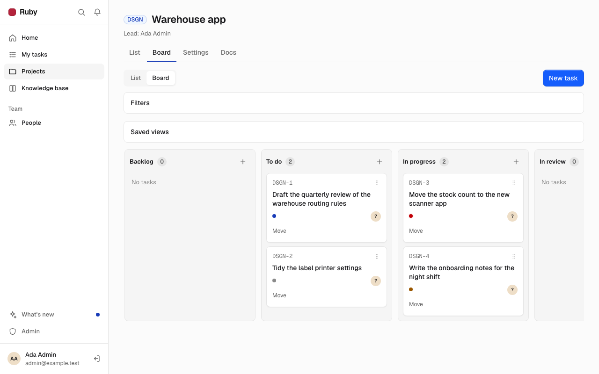
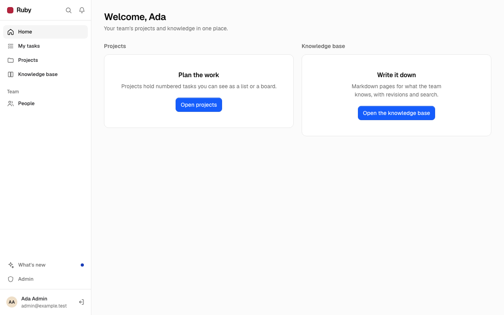
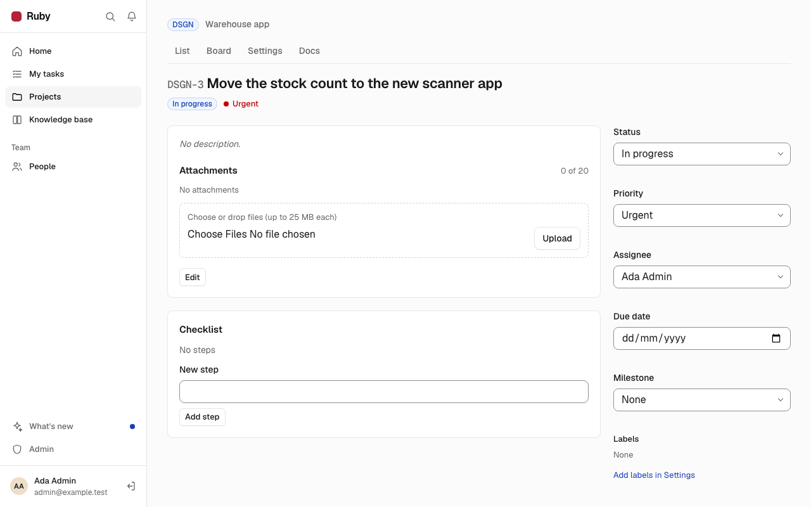
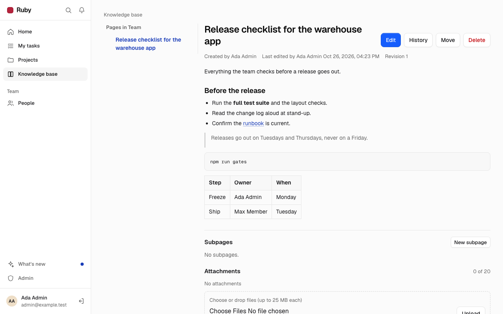
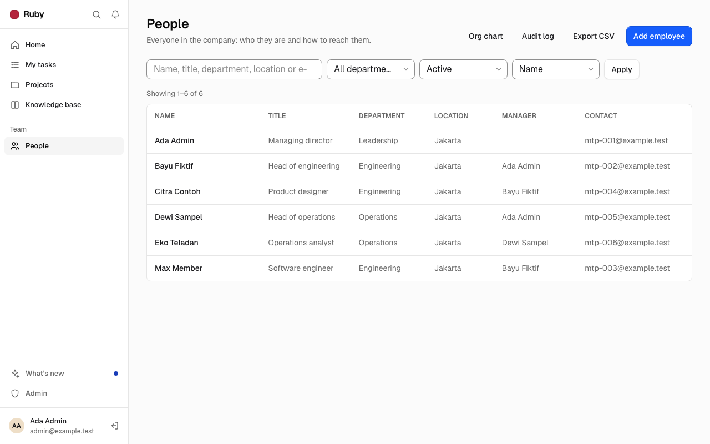

<div align="center">

# Ruby

**Projects, knowledge and people for one team, on one Cloudflare Worker.**

Tasks on a list or a board, a Markdown knowledge base with search, comments and attachments,<br>
an employee directory with encrypted HR data, and time off with approvals.

[](https://github.com/studiomicro/ruby/actions/workflows/ci.yml)
[](https://github.com/studiomicro/ruby/actions/workflows/codeql.yml)
[](LICENSE)


<br>



<sub>Screenshots use fictional demo data.</sub>

</div>

---

## What Ruby does

Ruby is the internal tool of a small company, built by [Macan Teknologi Perkasa](https://github.com/studiomicro) and
released as open source. It is not a suite: it covers the daily work of one team and nothing more.

- **Projects and tasks.** Status, assignee, due date and priority; a list view and a board view; soft delete
  with restore.
- **Knowledge base.** A page tree of Markdown pages with preview, revisions you can restore, and full-text search
  (SQLite FTS5) across pages and tasks.
- **Comments.** On tasks and pages, with @mentions and an in-app notification list.
- **Attachments.** Files stored in a private R2 bucket, served only through an authorised download route.
- **People and HR.** An employee directory. Sensitive fields (national id, tax and social-security numbers, bank
  account, address, salary) are encrypted with AES-256-GCM under a key only the Worker holds, and every reveal is
  audited.
- **Time off.** Requests, balances, approvals and a team calendar.
- **Release notes.** What changed in each version, inside the app.

<table>
<tr>
<td></td>
<td></td>
</tr>
<tr>
<td></td>
<td></td>
</tr>
</table>

Dark theme and phone layouts are in [`docs/design/screenshots/`](docs/design/screenshots/).

## Quick start (local development)

Node 22 or newer.

```sh
npm ci
npm run db:reset:local   # fresh local D1 with all migrations
npm run db:seed:local    # fictional sample data, local only
npm run dev
```

Sign in with the seed account `admin@example.test` and password `ruby-local-demo`. These exist only in your local
database. To use HR data locally, put `HR_DATA_KEY=<random value>` in `.dev.vars` (gitignored).

Before a pull request: `npm run gates` (type check, lint, tests, build).

## Self-hosting

Ruby needs a Cloudflare account with one Worker, one D1 database and one R2 bucket. The repository holds only
placeholders; your account id, database id and domain go into a gitignored `.deploy.env`, and `npm run deploy`
renders a temporary Wrangler config from them. Step by step: [docs/SELF_HOSTING.md](docs/SELF_HOSTING.md). Operations
and rollback: [docs/RUNBOOK.md](docs/RUNBOOK.md).

## Security model

- **Two gates.** Cloudflare Access in front of the host (the Worker verifies the signed JWT itself and fails closed),
  then Ruby's own invite-only accounts: nobody signs up, an admin invites. Access can be left out; the invite-only
  accounts stay.
- **Sessions and passwords.** Opaque session cookies stored hashed in D1; PBKDF2-SHA256 password hashing; identical
  answers for unknown e-mail and wrong password.
- **Every request is authorised on the server.** A hidden button is not authorization.
- **HR data is encrypted at rest** with `HR_DATA_KEY`, a Worker secret. Without it those fields are read-only.
- **Safe Markdown.** All user Markdown goes through one sanitising renderer.

Report a vulnerability privately: see [SECURITY.md](SECURITY.md).

## Contributing

Issues and pull requests are welcome. Read [CONTRIBUTING.md](CONTRIBUTING.md) and the
[Code of Conduct](CODE_OF_CONDUCT.md). Project rules for contributors and agents are in [CLAUDE.md](CLAUDE.md).

## Licence

[MIT](LICENSE) &copy; 2026 Macan Teknologi Perkasa. Third-party notices: [THIRD_PARTY_NOTICES.md](THIRD_PARTY_NOTICES.md).
